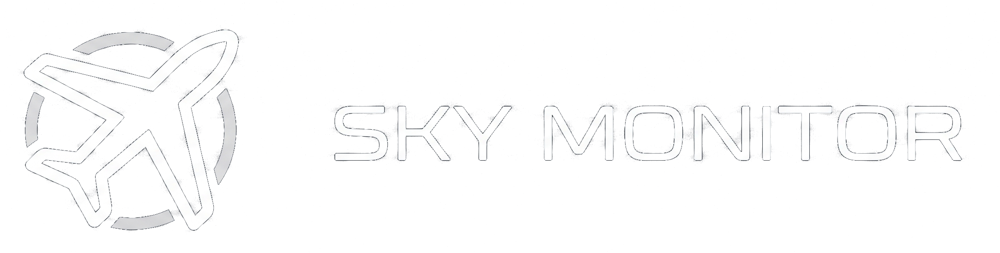
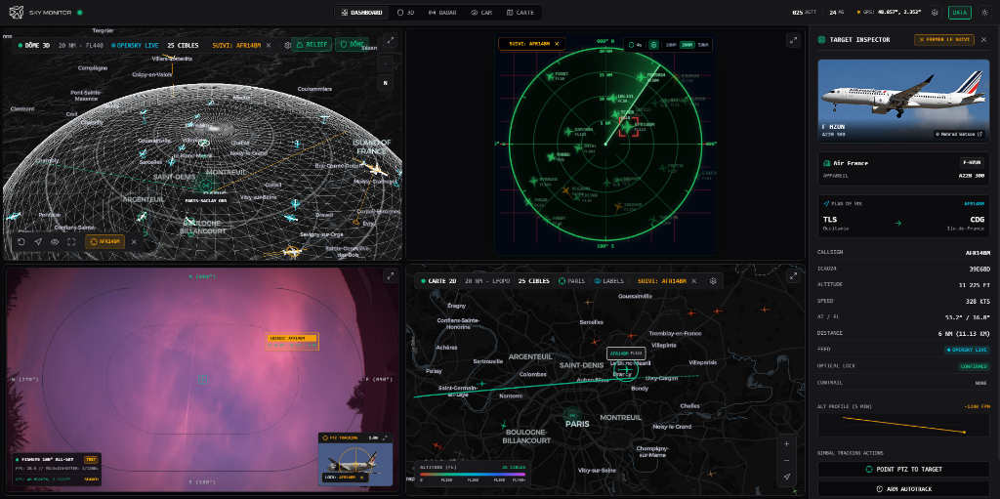
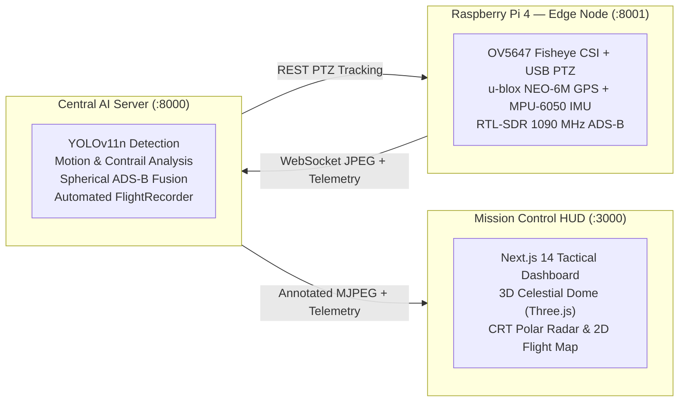

  <picture>
    <source media="(prefers-color-scheme: dark)" srcset="../assets/logo-dark-full-trans.png">
    <source media="(prefers-color-scheme: light)" srcset="../assets/logo-light-full-trans.png">
    
  </picture>

  <h3>Distributed Airspace Surveillance Platform</h3>
  
<strong>All-Sky Optical YOLOv11 Detection · 1090 MHz ADS-B Radar Fusion · 3D Mission Control HUD</strong>

  

    
    
    
    
    
    
  

   
  

---

## About SkyMonitor PI2

**SkyMonitor** is an autonomous, decoupled airspace observation system developed as part of the ESILV A4 PI2 engineering program. It pairs an all-sky optical fisheye camera and PTZ gimbal on a Raspberry Pi 4 edge node with a 1090 MHz ADS-B radio receiver and GPU-accelerated deep learning inference to detect, correlate, and track airborne targets in real time.

---

## System Architecture

---

## Platform Modules

| Module | Stack | Role |
| :--- | :--- | :--- |
| **Edge Node (`edge/`)** | Python, FastAPI, Picamera2, OpenCV | Hardware sensor acquisition (CSI/USB cameras, GPS UART, IMU I2C, RTL-SDR) and PTZ gimbal control |
| **Central AI Server (`server/`)** | Python, FastAPI, Ultralytics YOLOv11 | Real-time neural inference, contrail analysis, spherical optical/ADS-B fusion, and flight recording |
| **Mission Control (`frontend/`)** | Next.js 14, TypeScript, Three.js, MapLibre | Swiss ATC tactical dashboard with 3D celestial dome, CRT polar radar, dual camera HUD, and 2D map |
| **Shared Core (`shared/`)** | Pydantic v2, NumPy | Strongly-typed telemetry contracts and equidistant fisheye spherical projection math |
| **Training Pipeline (`training/`)** | PyTorch, Ultralytics, ONNX/TensorRT | Continuous dataset extraction from recorded flights and YOLO model fine-tuning |
| **Documentation (`docs/`)** | MkDocs Material | Full hardware wiring, API reference, mathematical models, and deployment guides |

---

## Organization Governance

All repositories inside `skymonitor-pi2` inherit our shared engineering standards:
- [Contribution Guide](../CONTRIBUTING.md)
- [Code of Conduct](../CODE_OF_CONDUCT.md)
- [Security Policy](../SECURITY.md)
- [Support & Documentation](../SUPPORT.md)
